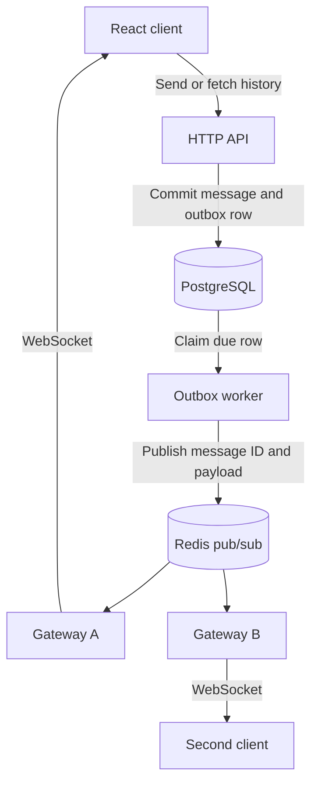

# EchoStream architecture

One Go executable runs the REST API, WebSocket gateway, PostgreSQL outbox relay and Redis subscriber. Every gateway in a deployment connects to the same database and the same dedicated Redis service. React talks to one origin through nginx in the Compose deployment.

## One send, three boundaries

1. **Commit.** The message store verifies tenant and membership, locks the channel before allocating a message ID, and checks the optional sender/channel-scoped request key. A new send inserts both the message and its outbox row in one transaction. Channel-level serialization prevents a later-committing message from appearing behind a client's confirmed cursor. Independent channels can write concurrently.
2. **Publish.** Each process has a relay. A worker claims a due row with `FOR UPDATE SKIP LOCKED`, publishes with a deadline, then removes the row. Failure schedules another attempt, with backoff capped at one minute. A worker crash after Redis accepts the publication can produce a duplicate. A committed outbox row records the obligation to publish. Delivery to an individual browser has no acknowledgment.
3. **Reconcile.** Each gateway subscribes to the Redis channel pattern before it starts accepting requests. Its Hub routes by channel to local sockets. The browser merges live frames and REST results by durable ID. Its recovery cursor advances from confirmed REST pages, so out-of-order live arrivals cannot skip older commits. It reconciles on subscribe, Redis resync, network restoration and a periodic timer. The live view retains a bounded window and exposes older history through pagination.

[PostgreSQL store](../internal/repository/postgres/message.go) · [Outbox claim and retry](../internal/repository/postgres/outbox.go) · [Browser history](../web/src/hooks/useChannelHistory.ts)

## Identity and access

Signup creates a workspace and its first user in one transaction, or resolves an invite into an existing workspace. Passwords use bcrypt. Signed, expiring JWTs carry the user and tenant. REST clients send a bearer header. Browsers offer two WebSocket subprotocol values, `echostream.v1` and `bearer.<JWT>`; the server selects the first. Native clients may use a bearer header. Configure the exact allowed browser origins.

The creator and their channel membership commit together. Other workspace users can discover and join public channels. Private channel details, roster and presence require membership. Reading or writing messages always requires membership. Before sending a queued channel frame, the gateway rechecks the recipient's membership against PostgreSQL. A datastore error closes that socket and lets the client reconnect. This check adds a database lookup per recipient per channel frame.

## HTTP and WebSocket protocol

| Method | Path under /v1 | Behavior |
| --- | --- | --- |
| POST | /auth/signup, /auth/login | Create an account or issue a JWT |
| GET | /health, /ready | Process liveness or dependency/schema readiness |
| GET | /ws | Upgrade an authenticated connection |
| GET, POST | /channels | List visible channels or create a channel |
| GET | /channels/:id | Read visible channel details |
| POST | /channels/:id/join, /leave, /invite | Join, leave, or add another workspace user to that channel |
| GET | /channels/:id/members, /channels/:id/presence | Read the roster or presence with pagination |
| POST | /channels/:id/messages | Save a message. Optional UUID Idempotency-Key header |
| GET | /channels/:id/messages | Newest first by default. Use exclusive before for older pages or exclusive after for ascending replay |
| GET | /users/me, /users | Current user or paginated workspace directory |
| POST | /workspace/invite | Generate an expiring workspace invitation |

A WebSocket client sends a JSON object with `type` and `channel_id`. Supported commands are `subscribe`, `unsubscribe` and `typing`. Wait for `subscribed` before relying on live updates. A `message` frame contains the saved message. A `resync` frame requests a history refresh. A `presence_refresh` frame invalidates the cached presence snapshot. The server can also return `unsubscribed` or `error`.

## Resource and failure boundaries

Each process admits up to 1,024 sockets, up to eight per user. Each socket can subscribe to 64 channels and buffers up to 64 outbound frames. A full buffer closes the connection so that a slow client can recover via history. These are admission limits and buffer settings. Measured concurrency and latency are recorded separately in the [benchmark](benchmarks/README.md).

A socket renews its own Redis presence lease every 30 seconds. Normal disconnect removes just that lease. After an unclean disconnect, its 90-second expiry bounds stale presence. Typing and immediate presence refresh notifications reach local subscribers. REST presence aggregates all active gateway leases.

Redis pub/sub has no per-client replay. A reconnecting gateway can miss an event even if publication succeeded, so history recovery is part of normal delivery. A PostgreSQL outage prevents authoritative sends and history reads. Running gateways can continue to commit authenticated requests during a Redis outage if traffic still reaches them. Readiness reports unavailable during that outage, and an ingress that removes all unready replicas may stop routing requests entirely.
